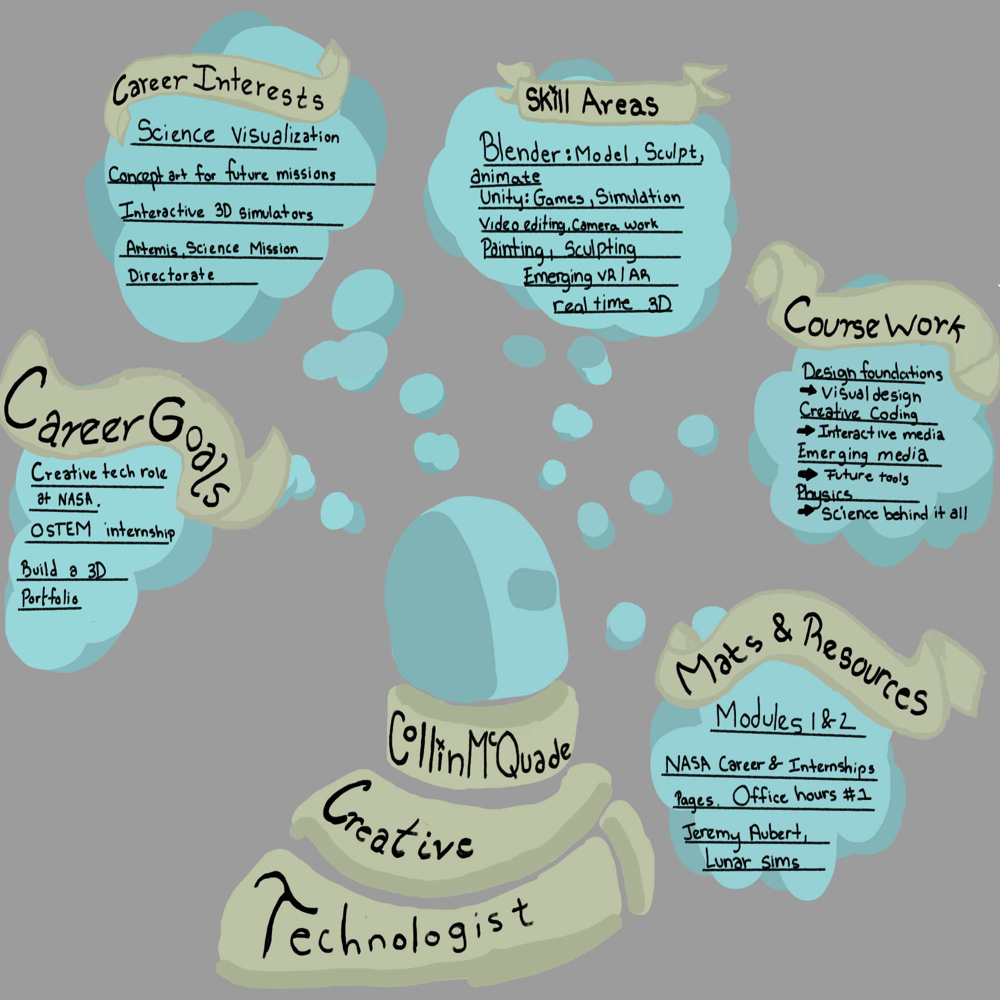

## Final Project Proposal — Collin McQuade

## Concept

For this concept I really want to showcase my creative side, and I’ve struggled with ways to do that beyond traditional art, which is part of why I switched into this course, to combine creativity with tools of technology. I want to use p5 as the canvas for a mind map style career portfolio, a space filled with my skills and projects that you open and explore freely. I struggle with feeling unorganized, and that makes me feel claustrophobic, so I end up rushing past the mess instead of sitting with it. I’m hoping that looking through my own creative career portfolio, even for me, will feel less messy and more organized, while still being creative and easy to move through. This is just the initial concept, and I expect I’ll struggle putting together a finished, real portfolio, but I hope this gets me off the ground and excited to keep polishing it.

## New Work or Built on Prior Work

This doesn’t build off anything I’ve done before conceptually, I’m learning a lot of this on the spot and diving into whatever interests me at the time. I’m using Short Study 7 to lay the groundwork for this project, to get moving in the right direction and start learning what I need to actually bring the idea across.

## Visuals

## Tools and Techniques

I feel confident with anything creative, and I’d like to apply skills I’m already somewhat comfortable with to the finished portfolio. Applying that to a p5 canvas is a skill I want to add, one that’ll come in handy later. I’m confident reading code to understand it, then messing with it to see what happens, I basically do a small research pass on any new piece of code I type so I actually understand it. There’s a lot I’ll need to look up and learn as I go, and that’s always been what excites me about this kind of work.

## Week-by-Week Plan

Between now and WIP1 (12/4): keep building out the camera system, start researching zoom, and begin figuring out how hand-drawn art will actually load into the sketch.

WIP1 due 12/4.

Between WIP1 and WIP2 (12/11): apply feedback, start replacing placeholder shapes with real hand-drawn pieces.

WIP2 due 12/11.

Between WIP2 and Final (12/18): apply feedback, finish remaining art, polish the navigation feel.

Final due 12/18.